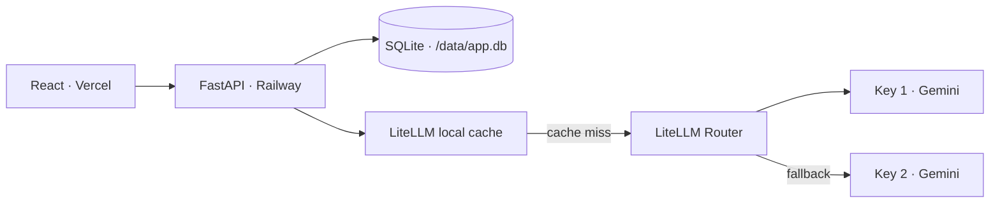

# Lyftr Chat

A conversational AI workspace built with **React, FastAPI, SQLite, and LiteLLM**. Chat across multiple turns, inspect each reply's inference metadata, and demonstrate caching and automatic API-key failover.

## 1. Live URLs

| Resource                   | Link                                                                                                         |
| -------------------------- | ------------------------------------------------------------------------------------------------------------ |
| Frontend · Vercel          | [lyftr-ai-assg.vercel.app](https://lyftr-ai-assg.vercel.app)                                                 |
| Backend API base · Railway | [lyftr-backend-production-f9237d5b.up.railway.app](https://lyftr-backend-production-f9237d5b.up.railway.app) |
| Backend health             | [GET /health](https://lyftr-backend-production-f9237d5b.up.railway.app/health)                               |
| Public source              | [rahulkumawat1707/lyftrAI-assg](https://github.com/rahulkumawat1707/lyftrAI-assg)                            |

Open the frontend to start a conversation. Each page load creates a new session; **New conversation** starts another without reloading. **Session settings** contains an optional system prompt, failure-simulation controls, and a saved-history reload button.

The hosted app runs independently of your laptop. Railway's free allowance and idle sleep can affect availability; the first request after sleeping may take longer. Local development links below are only accessible on the computer running the services.

## 2. Run locally: with Docker and without

### Get the source and configure it

```sh
git clone https://github.com/rahulkumawat1707/lyftrAI-assg.git
cd lyftrAI-assg
```

Copy `.env.example` to `.env` using your editor, then replace the key and model placeholders. Keep an existing `.env` if it already contains your configuration. Provide at least two distinct real keys and a model your provider account supports. For Gemini, the hosted configuration uses `gemini/gemini-3.5-flash-lite`.

### With Docker

Prerequisites: Docker with Compose, plus Make if using the Makefile.

```sh
make up
make down
```

Equivalent commands without Make:

```sh
docker compose up --build -d
docker compose down
```

| Local service  | Address                      |
| -------------- | ---------------------------- |
| React frontend | http://localhost:3000        |
| FastAPI health | http://localhost:8000/health |

Both services use multi-stage Dockerfiles. The named `sqlite_data` volume is mounted at `/data`; the database is `/data/app.db`. Stopping the stack with `make down` preserves that volume. Removing the volume deletes its stored history.

### Without Docker

Prerequisites: Python 3.12 and Node.js 22 with npm. Run from the repository root.

**Windows PowerShell:**

```powershell
python -m venv .venv
.\.venv\Scripts\python -m pip install -r backend/requirements-dev.txt
npm.cmd ci --prefix frontend
.\scripts\start-local.ps1
```

The start script runs both servers in the background and writes logs to `tmp/`. It leaves existing servers untouched if a required port is already occupied. Open http://127.0.0.1:3000; backend health is http://127.0.0.1:8000/health.

For foreground logs, run these commands in two separate terminals:

```powershell
.\.venv\Scripts\python -m uvicorn backend.app.main:app --host 127.0.0.1 --port 8000
npm.cmd run dev --prefix frontend -- --host 127.0.0.1
```

**macOS / Linux:**

```sh
python3 -m venv .venv
.venv/bin/python -m pip install -r backend/requirements-dev.txt
npm ci --prefix frontend
```

Then, in separate terminals:

```sh
.venv/bin/python -m uvicorn backend.app.main:app --host 127.0.0.1 --port 8000
npm run dev --prefix frontend -- --host 127.0.0.1
```

### Environment variables

| Variable                    | Purpose                                                                           |
| --------------------------- | --------------------------------------------------------------------------------- |
| `LLM_API_KEYS`              | Comma-separated provider keys, assigned `key_1`, `key_2`, etc. in order           |
| `LLM_MODEL`                 | Provider-supported LiteLLM model identifier                                       |
| `DATABASE_URL`              | SQLite location; local `sqlite:///./data/app.db`, Docker `sqlite:////data/app.db` |
| `ALLOWED_ORIGINS`           | Comma-separated frontend origins permitted by CORS                                |
| `ENABLE_FAILURE_SIMULATION` | `true` enables the request-scoped failure test header                             |
| `DEFAULT_SYSTEM_PROMPT`     | Assistant instructions used when the session has no override                      |
| `LLM_TIMEOUT_SECONDS`       | Timeout for each provider attempt; example: `25`                                  |
| `CACHE_TTL_SECONDS`         | Response-cache lifetime; example: `3600`                                          |
| `VITE_API_BASE_URL`         | Public backend base URL embedded in the React build                               |
| `PORT`                      | Container listening port; default: `8000`                                         |

The frontend reads the root `.env` at startup/build time. Restart local processes after configuration changes; redeploy the frontend after changing its backend URL. Include both `http://localhost:3000` and `http://127.0.0.1:3000` in local CORS origins if you use both addresses.

Keep real keys in `.env` or backend hosting secrets. Never use a `VITE_` prefix for a secret: those variables are included in the browser bundle. `.gitignore` excludes `.env`, local databases, dependencies, and generated output.

### Hosting configuration

- **Vercel:** root directory `frontend`, framework Vite, install `npm ci`, build `npm run build`, output `dist`. `frontend/vercel.json` includes the SPA fallback. Set production `VITE_API_BASE_URL` to the Railway HTTPS base URL.
- **Railway:** root directory `/backend`, Dockerfile builder, one instance, port `8000`, health check `/health`, and a persistent volume mounted at `/data`. Set `DATABASE_URL=sqlite:////data/app.db` and `ALLOWED_ORIGINS=https://lyftr-ai-assg.vercel.app`.
- Both projects follow the repository's `main` branch. Deploy configuration and credentials belong in the hosting settings, not the source tree. See [Railway deployment details](docs/deploy-railway.md).

## 3. Design decisions: key fallback, caching, SQLite session storage



**Key fallback.** Each configured key becomes an ordered LiteLLM deployment named `key_1`, `key_2`, and so on. Router tries the next key when an attempt fails, without retrying the same key. A request-scoped router keeps test failures and cooldown state from leaking into later requests. Metadata exposes key IDs, never credentials. If all providers fail, the API returns the specified JSON 503.

**Caching.** LiteLLM's built-in in-memory cache uses the model plus the full ordered message list: system prompt, stored history, and new message. Session IDs are excluded, so identical first messages in separate sessions can share a cache entry. A hit returns the stored reply and usage with `LLM_CACHE`, `key_id: null`, and zero fallback attempts. A different prompt or context produces a different entry. Cache entries expire at their TTL and are cleared on process restart.

**SQLite sessions.** Startup creates the schema and index automatically. Messages include session ID, role, content, optional assistant metadata as JSON, and a server-generated ISO-8601 timestamp. A successful user/assistant pair and session instructions are committed in one transaction. Invalid and unavailable-provider requests do not change stored history. Connections close after each transaction, and the mounted database survives container restarts.

**Conversation ordering.** Per-session locks serialize concurrent turns within one backend process. Different sessions can proceed independently. Use one backend worker/instance because locks and cache are process-local. The client sends only the new message; the server reconstructs the complete context from SQLite.

**Tokens and latency.** Input tokens count the current full prompt, including history; output tokens count only the new reply. Values come from provider usage, not estimates or accumulated conversation totals. Latency is server-measured integer milliseconds. Cache hits preserve original usage while reporting their own request latency.

Session UUIDs separate conversations but do not provide account authentication. The assignment API has no user-account access control; use test conversations rather than sensitive personal information.

## 4. Verification: how to see failover, cache hits and per-message token usage

### Automated checks

From the repository root on Windows:

```powershell
cd backend
..\.venv\Scripts\python -m pytest -q
cd ..
npm.cmd run build --prefix frontend
```

On macOS/Linux, use `../.venv/bin/python` from `backend` and `npm` in place of `npm.cmd`. Tests exercise the real LiteLLM Router and Cache with mocked provider responses. The production build checks the React bundle; it does not establish provider availability.

To check real keys locally:

```powershell
.\.venv\Scripts\python scripts/check_provider.py
```

To verify the public API, CORS, cache, fallback, validation, and history:

```powershell
.\.venv\Scripts\python scripts/verify_live.py --backend https://lyftr-backend-production-f9237d5b.up.railway.app --frontend https://lyftr-ai-assg.vercel.app
```

These checks make real model requests and consume provider quota. Verify persistence separately: save a conversation, restart the hosted backend, then fetch the same session's history.

### API contract

| Endpoint                              | Behavior                                                                                             |
| ------------------------------------- | ---------------------------------------------------------------------------------------------------- |
| `GET /health`                         | Database/configuration readiness: `status`, `keys_configured`, `cache_enabled`                       |
| `POST /chat`                          | Accepts `session_id`, `message`, optional `system_prompt`; returns `session_id`, `reply`, `metadata` |
| `GET /sessions/{session_id}/messages` | Stored messages, oldest first, without the system prompt                                             |

`session_id` is required, 1–128 characters. `message` is required, 1–4000 characters after trimming. Each successful reply includes `resolution_source`, `model`, `latency_ms`, `input_tokens`, `output_tokens`, `key_id`, and `fallback_attempts`.

| Error                            | HTTP status                                   |
| -------------------------------- | --------------------------------------------- |
| Invalid fields or malformed JSON | 422                                           |
| Unknown history session          | 404, `{"detail":"session not found"}`         |
| Every provider unavailable       | 503, `{"detail":"all providers unavailable"}` |

### See a cache hit

1. Start a new conversation and send a unique question. Inspect `LIVE_INFERENCE` and its metadata.
2. Start another conversation and send exactly the same question with the same system instructions.
3. Inspect `LLM_CACHE`: identical reply and token usage, null key ID, zero fallback attempts, and lower latency.
4. Change the question or system prompt to check that the cache distinguishes the request.

### Demonstrate failover

Enable `ENABLE_FAILURE_SIMULATION=true` on the backend. Use a fresh prompt for each test so an existing cache entry does not bypass inference. Select a failure mode in **Session settings**, or set the request header directly:

| `X-Simulate-Failure`  | Expected result with two keys         |
| --------------------- | ------------------------------------- |
| `key_1=429`           | Real reply from `key_2`, one fallback |
| `key_1=500`           | Real reply from `key_2`, one fallback |
| `key_1=429,key_2=500` | JSON 503; history unchanged           |
| `*=429`               | JSON 503; history unchanged           |

The header also accepts 502 and 503; the current 5xx test path uses LiteLLM's generic internal-server-error mock. Simulations apply only to that request. In the UI, the selected mode stays enabled for subsequent requests until reset to **Normal operation**.

### Manual PowerShell example

```powershell
$baseUrl = 'https://lyftr-backend-production-f9237d5b.up.railway.app'
$sessionId = [guid]::NewGuid().ToString()
$body = @{ session_id = $sessionId; message = 'What is the capital of France?' } | ConvertTo-Json
Invoke-RestMethod "$baseUrl/health"
Invoke-RestMethod "$baseUrl/chat" -Method Post -ContentType 'application/json' -Body $body
Invoke-RestMethod "$baseUrl/sessions/$sessionId/messages"
```

Each assistant message displays source, model, latency, input/output tokens, key ID, and fallback count. Required `data-testid` hooks are preserved: `chat-input`, `send-button`, `assistant-message`, `meta-source`, `meta-model`, `meta-latency`, `meta-input-tokens`, `meta-output-tokens`, and optional `system-prompt-input`.

## 5. Setup Used: your editor and AI tools

- **Editor:** Visual Studio Code.
- **AI coding assistant:** OpenAI Codex, used for implementation, documentation, dependency setup, testing, and deployment assistance.
- **Frontend tooling:** React, Vite, Lucide icons, React Markdown, and remark-gfm.
- **Backend tooling:** Python, FastAPI, Uvicorn, LiteLLM, sqlite3, pytest, and HTTPX.
- **Hosting:** Vercel for the static frontend; Railway for FastAPI and its mounted SQLite volume.

## 6. Bonus features (if any): what you added beyond the requirements and why

- **System prompts and conversation switching:** compare different instructions and contexts without reloading the page.
- **Markdown, tables, code blocks, and copy controls:** make generated answers easier to read and reuse.
- **Resilience controls and health indicator:** demonstrate fallback and inspect backend connectivity directly from the interface.
- **Saved-history reload:** inspect SQLite-backed session messages from the chat settings.
- **Responsive navigation and keyboard support:** keep the chat usable on smaller screens, with Enter to send, Shift+Enter for a new line, and Escape to close settings.
- **Windows background start script:** launch both local services with a single command and retain their logs.

### Submission reference

The assignment requests public frontend and backend URLs, the public GitHub repository, and a **2–3 minute screen recording with your own voice**, submitted through its form within 24 hours of receipt. The video should show the deployed application, all three endpoints, a cache hit, failover using `X-Simulate-Failure`, and per-request metadata. See [the demo outline](docs/demo-script.md) for a recording sequence.
